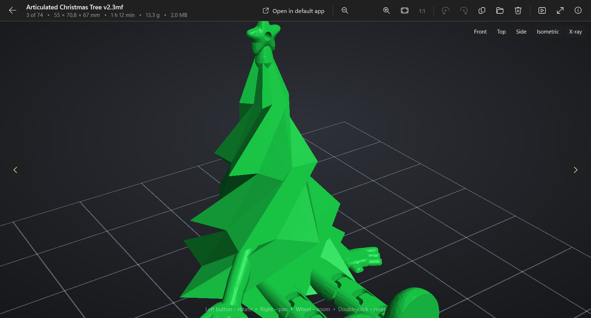
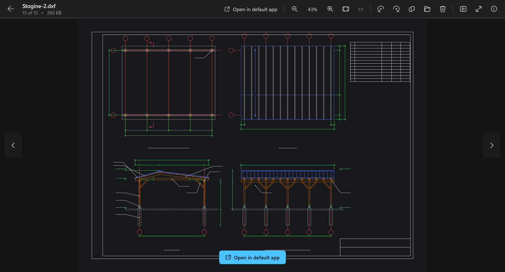
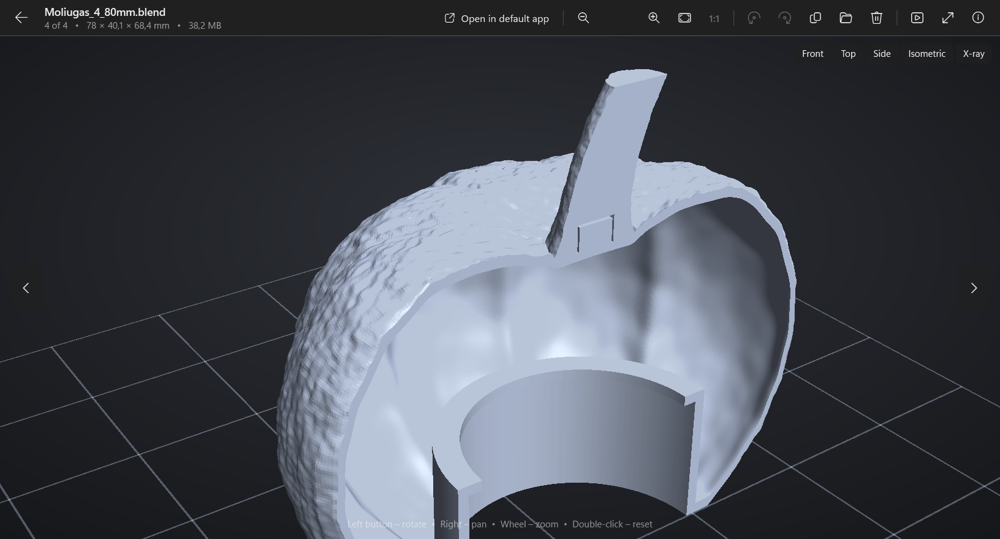
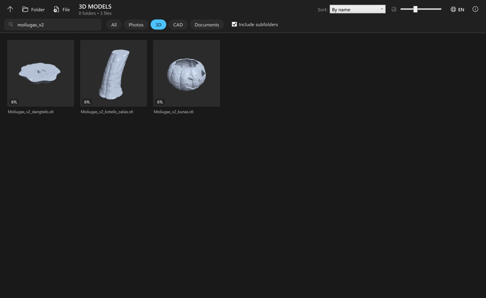

  

<h1 align="center">AllPicta</h1>

  <b>Free viewer for images, 3D models, CAD files and documents on Windows</b> 
  <b>Nemokama paveikslėlių, 3D modelių, CAD failų ir dokumentų peržiūros programa Windows</b>

  <a href="../../releases/latest"><b>⬇ Download / Atsisiųsti</b></a>

## English

AllPicta lets you browse folders and preview photos, 3D printing models, CAD drawings, PDF and office documents in one place.

**Features**
- **3D view of STL, OBJ and 3MF** – rotate, pan and zoom with the mouse, Front / Top / Side / Isometric views, X-ray mode, print bed grid, model size in mm. 3MF projects show all plates and filament colours, and for sliced projects also print time and filament usage.
- **CAD files** – previews for `.f3d`, `.f3z`, `.ipt`, `.iam`, `.idw`, `.ipn`, `.dwg`, `.dwt`, `.dxf`, `.dwf`, `.dwfx`, `.blend`. DXF drawings are rendered by AllPicta itself; `.blend` files are shown as real 3D models when a program that opens them is installed.
- **Documents** – PDF pages (built-in Windows PDF engine) and office documents (`.docx`, `.xlsx`, `.pptx`, `.doc`, `.xls`, `.ppt`, `.rtf`) through the installed office suite's preview handler.
- **Photos** – JPG, PNG, GIF, BMP, TIFF, WEBP, HEIC, AVIF, RAW and more; zoom up to 1600%, rotate, slideshow, full screen, EXIF info.
- **Gallery** – folder navigation, search, quick filters (Photos / 3D / CAD / Documents), "Include subfolders", sorting, adjustable thumbnails.
- **Lithuanian and English** interface, switchable at any time.

**Requirements**: Windows 10 or 11 (64-bit). Nothing else to install.
Some CAD thumbnails come from CAD programs installed on the PC; office previews need an installed office suite.

**Installation**: download `AllPicta-Setup.exe` from [Releases](../../releases/latest) and run it. No administrator rights are needed.
Windows may show *"Windows protected your PC"* because the installer is not code-signed – click **More info → Run anyway**.

| CAD drawing (DXF) | 3D view of a .blend file |
|---|---|
|  |  |

## Lietuviškai

AllPicta leidžia vienoje vietoje naršyti po aplankus ir peržiūrėti nuotraukas, 3D spausdinimo modelius, CAD brėžinius, PDF ir biuro dokumentus.

**Galimybės**
- **STL, OBJ ir 3MF 3D peržiūra** – sukimas, slinkimas, artinimas pele, vaizdai Priekis / Viršus / Šonas / Izometrija, permatomas režimas, spausdinimo pagrindo tinklelis, matmenys mm. 3MF projektuose matomos visos plokštės ir gijų spalvos, o supjaustytuose – ir spausdinimo laikas bei gijos kiekis.
- **CAD failai** – `.f3d`, `.f3z`, `.ipt`, `.iam`, `.idw`, `.ipn`, `.dwg`, `.dwt`, `.dxf`, `.dwf`, `.dwfx`, `.blend` peržiūros. DXF brėžinius nubraižo pati AllPicta; `.blend` failai rodomi kaip tikri 3D modeliai, jei įdiegta juos atidaranti programa.
- **Dokumentai** – PDF puslapiai (Windows PDF variklis) ir biuro dokumentai (`.docx`, `.xlsx`, `.pptx`, `.doc`, `.xls`, `.ppt`, `.rtf`) per įdiegtos biuro programos peržiūros tvarkyklę.
- **Nuotraukos** – JPG, PNG, GIF, BMP, TIFF, WEBP, HEIC, AVIF, RAW ir kt.; artinimas iki 1600 %, pasukimas, skaidrės, visas ekranas, EXIF informacija.
- **Galerija** – aplankų naršymas, paieška, greiti filtrai (Nuotraukos / 3D / CAD / Dokumentai), „Su poaplankiais“, rikiavimas, keičiamas miniatiūrų dydis.
- Sąsaja **lietuvių ir anglų** kalbomis, kalbą galima perjungti bet kada.

**Reikalavimai**: Windows 10 arba 11 (64 bitų). Nieko papildomai diegti nereikia.
Dalį CAD miniatiūrų pateikia kompiuteryje įdiegtos CAD programos; biuro dokumentų peržiūrai reikia įdiegtos biuro programos.

**Diegimas**: atsisiųskite `AllPicta-Setup.exe` iš [Releases](../../releases/latest) ir paleiskite. Administratoriaus teisių nereikia.
Windows gali parodyti *„Windows apsaugojo jūsų kompiuterį“*, nes diegimo programa nepasirašyta sertifikatu – spauskite **Daugiau informacijos → Vis tiek paleisti**.

## License / Licencija

AllPicta is **freeware** (closed source). You may use it for free and redistribute the unmodified installer. See [LICENSE.txt](LICENSE.txt).
AllPicta yra **nemokama programa** (uždaro kodo). Ją galima naudoti nemokamai ir platinti nepakeistą diegimo failą.

Uses [Zstandard](https://github.com/facebook/zstd) (BSD license).
Other product names and trademarks belong to their respective owners; AllPicta is not affiliated with them.

© 2026 AudriusV
